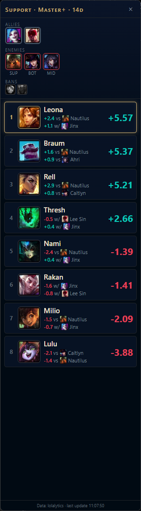

# LoL Champion Recommender

Live champ select pick recommender for League of Legends. Reads the draft from the local League
Client API, detects the role you're assigned, pulls last-14-days matchup and synergy stats from
lolalytics, and ranks picks from your champion pool for that role. Shows a panel docked beside
the League client.



Each score is the pick's baseline win rate plus weighted matchup deltas vs enemies and synergy deltas with allies;
the lines under each pick show its two biggest contributions. Hover or click a pick to see every
matchup and synergy behind its score: the delta, the games it's based on, and its weighted value.

## Run
```
uv sync
uv run app.py                            # live
uv run app.py --record drafts/x.jsonl    # live + record the draft
uv run app.py --replay drafts/x.jsonl    # replay a recorded draft
uv run app.py --simulate --role support --allies jinx,leesin --enemies nautilus,caitlyn --bans pyke
uv run pytest
```
Ctrl+Shift+L toggles the panel. Ctrl+C in the terminal quits.

## Rank tier
The pill at the top of the panel switches the stats between **Master+**, **GM+** and **Challenger**.
The choice is remembered between runs. Each tier is cached separately for the day.

Higher tiers have far fewer games. Over 14 days, lolalytics lists about 54 support matchups for Thresh
at Master+, 14 at GM+ and none at Challenger. When few matchups are available, the panel says so and the
scores mostly reflect each champion's overall win rate. Lane guessing for enemies always uses
Master+ data.

## Roles
The role always comes from your assigned position in champ select (ranked and normal draft). Queues
that don't assign positions (blind pick, ARAM) show a notice instead of recommendations.

Edit `config.toml` to set:
- **`[pools]`**: the champion pool for each role. Only these champions are ranked.
- **Lane weights:** by default your lane opponent counts most, bot and support also weigh the enemy
  duo and their own duo partner, and the jungler matters to every lane. Override them per role under
  `[weights.<role>]`.
- **`k`:** sample-size shrinkage. Lower it if rankings feel too flat with thin master+ samples.

The first draft in a role each day loads that role's stats, about 60 requests and roughly 15 seconds;
after that they come from cache.

## Enemy lanes and flex picks
The client doesn't say which lane each enemy plays, so lanes are guessed from each champion's play rates.
Champions with a real second lane (10% or more of their games, e.g. Hwei mid/bot) get a gold dot. Click
any enemy to pick their lane: the picker shows the play rate for each lane, and the other enemies are
re-guessed around your choice. **Auto** goes back to the guess. Your choices reset each draft.

## Build an .exe
```
uv run --group build pyinstaller league_helper.spec --noconfirm
```
Output: `dist/LeaguePickHelper/`. When packaged, config/cache/logs live in `%LOCALAPPDATA%\league-analysis\`.

## Notes
- lolalytics has no official API; endpoints are undocumented (`lolalytics.py`) and may change. Responses are cached for 24h.
- Reading the League Client API is read-only; nothing is injected into the client or game.
