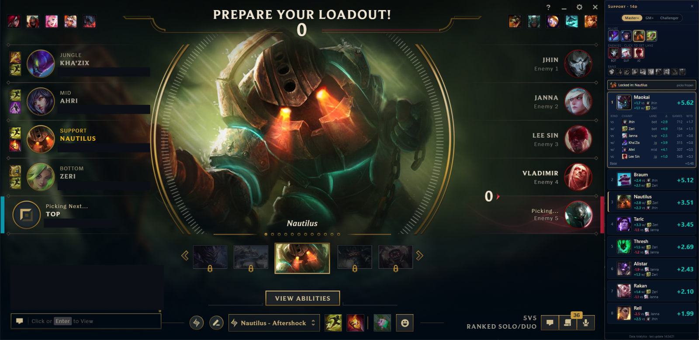
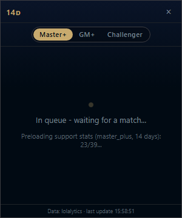
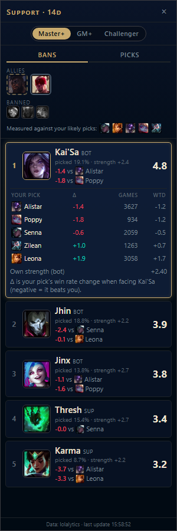
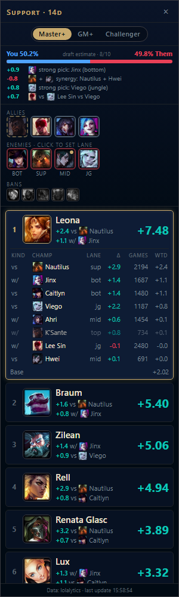
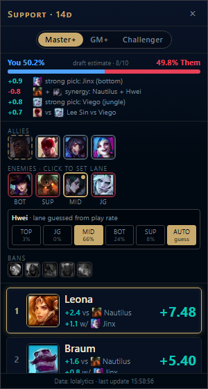
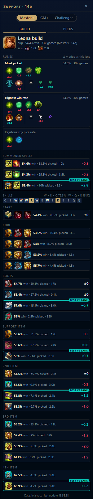
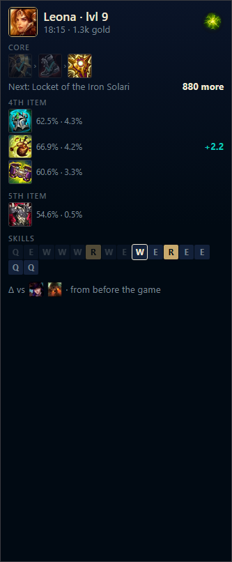

# LoL Companion

Live champ select pick recommender for League of Legends. Reads the draft from the local League
Client API, detects the role you're assigned, pulls last-14-days matchup and synergy stats from
lolalytics, and ranks every viable champion you own for that role. Shows a panel docked beside
the League client.



Each score is the pick's baseline win rate plus weighted matchup deltas vs enemies and synergy deltas with allies;
the lines under each pick show its two biggest contributions. Hover or click a pick to see every
matchup and synergy behind its score: the delta, the games it's based on, and its weighted value.

## Views
Every stage has its own view. These are simulated (`uv run scripts/simulate_views.py`), using the
real controller and live lolalytics data: support with K'Sante (hovering), Lee Sin, Ahri and Jinx
vs Caitlyn, Nautilus, Hwei and Viego.

| Queue | Bans | Picks + draft estimate |
|---|---|---|
|  |  |  |
| Stats for your preferred roles preload while you queue. | Optional ban suggestions (`show_ban_suggestions`), Kai'Sa expanded. | Your draft's estimated win % with the biggest reasons, then ranked picks (Leona expanded). |

| Flex lane picker | Build after lock-in | In game (Ctrl+Shift+B) |
|---|---|---|
|  |  |  |
| Click an enemy to set their lane (Hwei: mid 66%, bot 24%). | Runes, spells, skills and items with Δ vs your lane opponents. | Core build with owned items ticked, gold to the next item, skill order at your level. |

## Run
```
uv sync
uv run app.py                            # live
uv run app.py --record drafts/x.jsonl    # live + record the draft
uv run app.py --replay drafts/x.jsonl    # replay a recorded draft
uv run app.py --simulate --role support --allies jinx,leesin --enemies nautilus,caitlyn --bans pyke
uv run pytest
```
The panel shows while the League client is in front: in the lobby, in queue and at the ready check
it shows where you are, and in champ select it shows the recommendations. It hides in game.
Ctrl+Shift+L toggles the panel, Ctrl+Shift+B the in-game panel. Ctrl+C in the terminal quits.

## Rank tier
The pill at the top of the panel switches the stats between **Master+**, **GM+** and **Challenger**.
The choice is remembered between runs. Each tier is cached separately for the day.

Higher tiers have far fewer games. Over 14 days, lolalytics lists about 54 support matchups for Thresh
at Master+, 14 at GM+ and none at Challenger. When few matchups are available, the panel says so and the
scores mostly reflect each champion's overall win rate. Lane guessing for enemies always uses
Master+ data.

## Roles
The role always comes from your assigned position in champ select (ranked and normal draft). Queues
that don't assign positions (blind pick, ARAM) show a notice instead of recommendations.

Edit `config.toml` to set:
- **`min_pick_rate`** (default 1.0): candidates are every champion on lolalytics' tier list for your
  role with at least this % pick rate (Master+, 14 days), narrowed to champions you own. About 35-50
  per role at 1%. Lower it to include off-meta picks.
- **Lane weights:** by default your lane opponent counts most, bot and support also weigh the enemy
  duo and their own duo partner, and the jungler matters to every lane. Override them per role under
  `[weights.<role>]`.
- **`k`:** sample-size shrinkage. Lower it if rankings feel too flat with thin master+ samples.

The first draft in a role each day loads stats for that role's candidates, about 6 requests each,
6 at a time, around 10-30 seconds; after that they come from cache.

## Draft win estimate
The top of the picks view shows your team's estimated win % vs theirs, updated with every pick,
hover and lane change, plus the biggest reasons ("+0.9 strong pick: Jinx", "-0.8 synergy:
Nautilus + Hwei"). It adds, in percentage points:
- each champion's own strength in its lane (shrunk win rate delta, at half weight because summing
  five deltas overstates),
- every cross-team matchup delta, measured from both champions' sides and averaged, weighted 1.0
  for the same lane, 0.7 between the bot-lane duos and 0.35 across other lanes,
- synergy between teammates (half weight); hovers count half; capped at 25-75%.

Stats for all 10 champions load in the background as they're picked. It's an **estimate**, not yet
calibrated: backtesting against your recorded drafts and results is what will tune these weights
(`[odds]` in `config.toml` overrides them).

## Lobby, queue and bans
In the lobby and in queue the panel loads stats for your first and second position preference
in the background, so recommendations are ready the moment champ select opens.

Recommendations start with the **first locked pick** of the draft (either team), or when your turn
starts if you're first pick. Before that, including the whole ban phase, the panel just shows where
the draft is. Set `show_ban_suggestions = true` in `config.toml` to see **Bans** there
instead: enemy champions worth banning, scored by how
likely you are to face them (their pick rate in each lane) times how much they hurt you (how
your likely picks do against them, shrunk by games, plus their own strength), weighted by lane.
Hover a suggestion to see the matchup against each of your picks. Your team's picks and hovers
and your own top picks are never suggested. Switch to **Picks** with the tab at the top.

## After you lock in: runes and build
The panel switches to **Build** for your champion in your role (the **Picks** tab still shows the
frozen recommendations): rune pages (most picked and highest win rate), keystones, summoner
spells, skill order, start items, core paths, boots and each item slot, with win rate, pick rate
and games.

Every option also gets a **Δ vs your lane opponents** (your lane, plus the enemy duo for bot and
support), read from lolalytics' matchup build pages: `(option win rate vs them - your win rate vs
them) - (option win rate overall - your win rate overall)`, shrunk by games (k = 300, under 100
games hidden). Positive means it does better than usual in this matchup. The strongest is tagged
**BEST VS LANE**; hover any option for each opponent. Nothing is imported into the client: you
set your runes and items yourself.

## In game (Ctrl+Shift+B)
Press **Ctrl+Shift+B** in game to show a compact build panel on the right edge of the game,
above the minimap (press again to hide; it remembers your choice for the next game). It shows
your core build with the items you already own ticked, the next item and how much more gold it
needs, item options with their Δ vs your lane opponents, and the skill order at your level.
Clicks pass through it to the game.

It only reads the game's local data for your own champion, items, gold and level, plus every
player's champion and position. It never uses enemy items or timers: everything it suggests was
worked out from data available before the game (Riot's third-party policy). Needs **borderless**
or **windowed** display mode; exclusive fullscreen draws over any other window.

## Your champions (comfort)
Scores include what you're good at:
- **you:** your win rate on the champion in that role minus everyone's, shrunk hard (k = 20)
  because personal samples are small. Comes from your ranked games, which the app copies from the
  client's match history after every game (the client itself only shows ~20).
- **mastery:** a small bonus for mastery points, capped at +1.0.

Tune or turn it off in `config.toml` with `[comfort]` (`weight = 0` disables it), or set
`comfort_only = true` to only see champions you've played.

## Enemy lanes and flex picks
The client doesn't say which lane each enemy plays, so lanes are guessed from each champion's play rates.
Champions with a real second lane (10% or more of their games, e.g. Hwei mid/bot) get a gold dot. Click
any enemy to pick their lane: the picker shows the play rate for each lane, and the other enemies are
re-guessed around your choice. **Auto** goes back to the guess. Your choices reset each draft.

## Build an .exe
```
uv run --group build pyinstaller league_helper.spec --noconfirm
```
Output: `dist/LoLCompanion/`. When packaged, config/cache/logs live in `%LOCALAPPDATA%\league-analysis\`.

## Layout
- `app.py`: window, docking and hotkeys. `controller.py` turns client updates into panel views
  and records drafts; `state.py` tracks where you are (lobby, queue, ban, pick, locked, in game).
- `engine.py` + `scoring.py`: candidates and scores. `views.py`: what the panel is sent.
- `data/`: lolalytics (with matchup builds read from the site's pages), Data Dragon, the shared
  fetcher (rate limit, de-duplication) and cache, and `store.py`, a SQLite file in
  `%LOCALAPPDATA%\league-analysis\store.sqlite` that records every draft for backtesting.
- `panel/`: `index.html` + `panel.css`, `js/core.js` (helpers, view router), one file per view in
  `views/`, and `js/demo.js` (open `index.html?demo` in a browser).
- `scripts/render_panel.py`: headless screenshot of any view, for checking UI changes;
  `scripts/simulate_views.py` renders every view from a simulated draft into `docs/views/`.

## Notes
- lolalytics has no official API; endpoints are undocumented (`lolalytics.py`) and may change. Responses are cached for 24h.
- Reading the League Client API is read-only; nothing is injected into the client or game.
